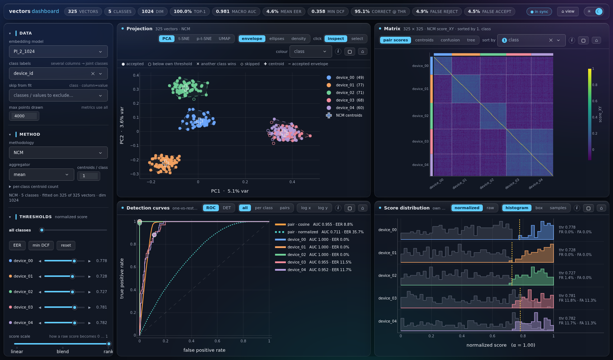

# vectors_dashboard

Interactive explorer for embedding vectors (speaker / device embeddings): how well do classes separate, where do thresholds sit, which samples are confused — in four synchronized panels.



## Run

```bash
python _runserver.py                 # synthetic demo  → http://127.0.0.1:8070/
python _runserver.py --real          # real embeddings (data/embeddings/*.parquet, not in the repo)
```

or in a notebook (`run.ipynb`):

```python
from frontend import Gui            # code/ on sys.path
gui = Gui.demo()                    # or Gui(df, wav_dir=...) / Gui.from_arrays(vectors, labels)
gui.run(port=8070, mode="inline", height=900)
```

`df` needs `session_id`, `model_name` and a vector column (`centroid`); every other column can be used as class labels, colour, filter or matrix sort key.

## Panels

| panel | shows |
|---|---|
| Projection | PCA · t-SNE · UMAP · parametric t-SNE (train button); accepted envelope, covariance ellipses, density; lasso / click selection |
| Matrix | pair scores (multi-key sort, numbered), class prototypes, confusion at the current thresholds, class tree |
| Detection curves | ROC / DET per class and for pairs; drag an operating point along its curve to move that class's threshold |
| Score distribution | target vs non-target per class (histogram, box, samples), normalized or raw scores, threshold lines |

Around them: per-class thresholds (sliders, EER, min DCF), a stats column for the clicked vector / pair / class, an audio dock with [WavLens](https://github.com/Michael-Soloveitchik/WavLens) when wav files are available, own labels, exports, light / dark theme, full-screen panels.

Every action is a transaction: the indicator in the top bar shows `● in sync` only when all panels agree with the controls.

## Layout

```
code/frontend/   the dashboard (engine · figures · callbacks · layout · assets)
code/backend/    representations (NCM, KNN, …), reductions, curves
data/            synthetic data generator, real-data loader
summaries/       architecture.md — how it is built and why
DELETE_ME_LATER/ tests (engine, concurrency, edge cases, browser audit) and the previous frontend
```

Details: [summaries/architecture.md](summaries/architecture.md).
